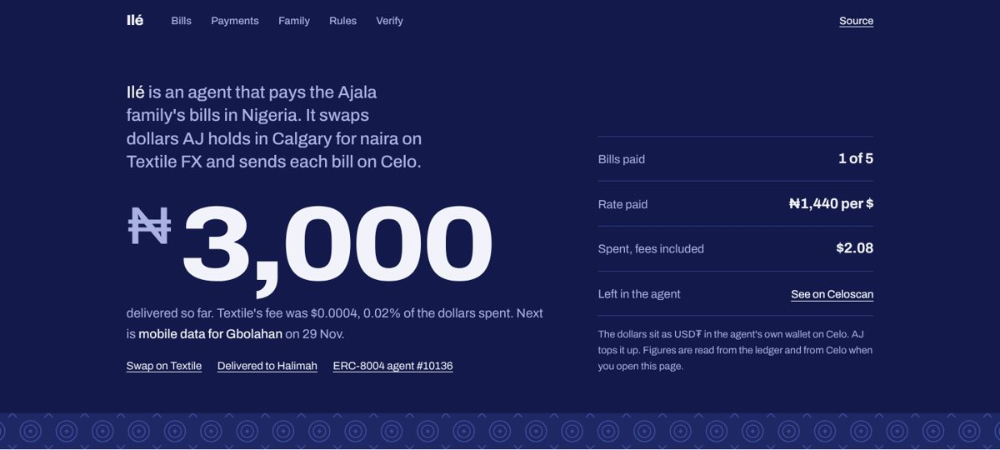

# Ilé



Ilé is an agent that pays a Nigerian family's household bills in naira from US dollars held abroad. The name is Yoruba for home. It holds USD₮ on Celo, and on the day each bill is due it buys the exact naira amount as cNGN on Textile FX and sends it to the family member, inside spending limits the sender sets.

It is used by one real family: AJ in Calgary, paying bills for his sister Halimah, his brother Gbolahan and his cousin Eniola in Nigeria.

- Live page: https://ile-family.pages.dev
- Mirror: https://ile-docs.vercel.app
- Data as JSON: [ledger](https://ile-family.pages.dev/data/ledger.json), [household](https://ile-family.pages.dev/data/household.json), [identity](https://ile-family.pages.dev/data/identity.json). The agent copies these into the site after every run.
- Agent wallet: [`0x2E5b3E46Db5d842EF5be17867900C428E635eB51`](https://celoscan.io/address/0x2E5b3E46Db5d842EF5be17867900C428E635eB51)
- ERC-8004 identity: [agent #10136](https://celoscan.io/tx/0xcaf4f0c291eb4d8808fd4ef40cc7ec67df85441f0a8197374a9ef1198e2d3195)
- Attribution tag on every transaction: `celo_10e86a43fdc3`
- Built for Celo's Agents Open for Business hackathon, in the Stablecoin Corridors track with Textile FX

## For judges: five minutes

1. **See the first real payment.** This is Halimah's ₦3,000 electricity top-up, paid on 26 November 2026, Lagos time:

   | Step | Transaction |
   |---|---|
   | Approve exactly 2.0832 USD₮ to Textile's reactor | [0x21f6…b436](https://celoscan.io/tx/0x21f6e836f0f9b3dc2304ea0953c6d94d103eb2ce2640607a782c77dcff64b436) |
   | Textile FX swap: 2.0832 USD₮ in, 3,000 cNGN out | [0x7e96…5802](https://celoscan.io/tx/0x7e9690d4476337911440f899f30ac7597cc632e002b7f603f412e1fab1a65802) |
   | Transfer 3,000 cNGN to Halimah | [0x8ac5…d966](https://celoscan.io/tx/0x8ac50e58fa1f5e907cd0e9ccdc4b9b37da68e884e2ae1944c32f7f9a69afd966) |

2. **See that it arrived.** Her reply, shared with her permission: *"I got my ₦3,000 for the light bill."* The screenshot, cropped to remove contact details, shows her MetaMask on Celo with 3,000 cNGN in the wallet the agent paid: [`docs/evidence/halimah-electricity-received.jpg`](docs/evidence/halimah-electricity-received.jpg).

3. **Check it yourself, with no keys.** This rebuilds every payment in the ledger from the chain alone: who sent each transaction, whether it carries the tag, what went in and out of the swap, and what reached the recipient.

   ```bash
   git clone https://github.com/Plutoski/ile && cd ile
   npm ci && npm run verify
   ```

4. **Watch it run.** The agent runs on [GitHub Actions](https://github.com/Plutoski/ile/actions/workflows/agent.yml) every four hours and commits its ledger back to [`data/ledger.json`](data/ledger.json). Every run's log is public.

### Track requirements

| Requirement | Where |
|---|---|
| A tagged Textile FX conversion on Celo mainnet, in a listed corridor, used in the product flow | USD₮ to cNGN swap [0x7e96…5802](https://celoscan.io/tx/0x7e9690d4476337911440f899f30ac7597cc632e002b7f603f412e1fab1a65802), bought to pay a bill. It calls Textile's reactor, [`0xa9AA0a64769cBed4d3B1Ceb4Df01CdE915C235b3`](https://celoscan.io/address/0xa9AA0a64769cBed4d3B1Ceb4Df01CdE915C235b3), which Celoscan shows without a name |
| A local-stablecoin payment that reaches a recipient outside the team | 3,000 cNGN to Halimah, [0x8ac5…d966](https://celoscan.io/tx/0x8ac50e58fa1f5e907cd0e9ccdc4b9b37da68e884e2ae1944c32f7f9a69afd966) |
| An ERC-8004 identity, registered from the agent wallet | Agent #10136, [0xcaf4…3195](https://celoscan.io/tx/0xcaf4f0c291eb4d8808fd4ef40cc7ec67df85441f0a8197374a9ef1198e2d3195). The agent card is at [ile-family.pages.dev/agent.json](https://ile-family.pages.dev/agent.json), the address registered on chain, with a copy at [ile-docs.vercel.app/agent.json](https://ile-docs.vercel.app/agent.json) |
| Attribution tag on every counted transaction | The tag is attached once, where the wallet client is built in [`src/chain.ts`](src/chain.ts). [`test/tagging.test.ts`](test/tagging.test.ts) proves approvals, swaps and transfers all carry it. |
| No arbitrage, self-trading or maker activity | The agent only ever takes quotes, to pay bills |
| Gas | Paid by the agent wallet itself, in USD₮ through Celo fee abstraction. No sponsored gas. |

## The job

Sending money home usually means paying a remittance fee, accepting the sender's rate, and then the family still has to pay each bill. Ilé turns that into a standing instruction: *pay Halimah's electricity on the 28th, Gbolahan's data on the 29th, Eniola's transport on the 1st*.

The household lives in one file, [`household.json`](household.json): who the recipients are, what each bill is for, the naira amount, the date, and the sender's limits. The schedule for this entry:

| Recipient | Bill | Amount | Due |
|---|---|---|---|
| Halimah, sister | Prepaid electricity top-up | ₦3,000 | 28 Nov. Paid 26 Nov, started by hand as the first live test |
| Gbolahan, brother | Mobile data | ₦2,000 | 29 Nov |
| Eniola, cousin | Transport for the week | ₦2,500 | 1 Dec |
| Halimah | Market and household upkeep | ₦2,000 | 3 Dec |
| Gbolahan | Airtime | ₦2,000 | 5 Dec |

## How one bill is paid

1. **Is it due?** A bill is due once its date has arrived in Nigerian time, which is UTC+1, and the bill has not been paid for that period.
2. **What is the rate?** The agent fetches the CBN's official USD/NGN rate from two free sources. If they disagree by more than 5%, it trusts neither and waits.
3. **Firm quote.** The agent asks Textile FX for a firm quote that delivers exactly the bill's naira amount. It proves control of its wallet with an EIP-712 signature.
4. **Checks before any money moves.** The quote must be bound to the agent's wallet, point at Textile's reactor and nothing else, deliver the requested amount, stay under the per-bill and monthly caps, not be about to expire, and be no worse than the rate floor. If any check fails, the quote is cancelled, nothing moves, and the reason is written to the ledger.
5. **Approve exactly what is needed.** USD₮ rejects changing one non-zero allowance to another, so a leftover allowance is reset to zero first. The approval is never unlimited.
6. **Swap, then record.** The agent sends Textile's swap transaction and reads what it received from the swap's own receipt. The payment is saved as *bought* before anything else happens.
7. **Deliver.** It sends the cNGN to the recipient and marks the bill *paid*.

Each transaction's hash is saved the moment it is broadcast, before the agent waits for it to be mined. If a run stops at any point, the next run checks those hashes on chain before doing anything new. A swap that went through is only delivered, a swap that reverted is bought fresh, and a transfer that went through is marked paid without sending again. A recorded transaction with no receipt 30 minutes after it was sent is redone. A resent transfer reuses the first one's nonce, so if the first was only delayed, at most one of the two can land. As a last guard, the agent will not buy if its wallet already holds naira that no recorded payment explains.

The agent is plain code with fixed rules. There is no language model in it.

## Rules it cannot break

From [`household.json`](household.json), enforced in [`src/policy.ts`](src/policy.ts):

- At most **$3 per bill** and **$10 per month**, Textile's fee included.
- A rate no worse than **3% below the official rate**.
- Naira only goes to the **wallets listed** in the household file.
- The agent approves and calls **Textile's reactor and nothing else**, for the exact amount of each swap.
- It only runs with **its own key**: it refuses to start if the configured key belongs to any other wallet.

These rules live in the agent's code, not in a smart contract.

## Where the money sits

The family's dollars sit as USD₮ in the agent's own wallet on Celo, [`0x2E5b…eB51`](https://celoscan.io/address/0x2E5b3E46Db5d842EF5be17867900C428E635eB51). One private key can move them. AJ holds it, and the agent uses it from a GitHub Actions secret. AJ tops the wallet up when it runs low.

## What it costs

On the first payment, Textile's fee was 0.000416 USD₮ and the swap's gas, paid in USD₮, was about 0.0031. Together that is about 0.17% of the $2.08 spent. Sending the same money through a remittance service typically costs several percent in fees and rate margin.

Textile paid ₦1,440 per dollar. That matches Nigeria's street rate that week and is about 6% more than the CBN's official ₦1,360. Ilé gets the market rate; it does not beat it.

## Status, including what went wrong

**Working on mainnet**

- ERC-8004 registration, tagged.
- One bill paid end to end: ₦3,000 to Halimah, confirmed by her.
- Four more bills scheduled through 5 December. The agent pays each one on its own when it falls due.

**The first payout failed halfway, and was finished safely.** On the first live run the swap succeeded. The agent then checked its cNGN balance to see what arrived, and the public Celo node answered from a server one block behind, so it saw nothing new. The agent refused to record a payment it could not confirm and stopped. The 3,000 cNGN stayed in the agent's own wallet. That failure is still in the public log.

The fix has three parts:

- The agent now reads what a swap delivered from the swap's own receipt, not from a follow-up balance read.
- A new step adopts a completed swap after checking it on-chain. The swap must come from the agent, go to Textile, carry the tag, and deliver exactly the bill amount. The agent then records it as *bought* without buying again. Running `pay halimah-electricity:<swapHash>` did this and delivered the naira.
- A regression test in [`test/receipts.test.ts`](test/receipts.test.ts) reproduces the stale read.

**Hardened after an independent review on 27 November.** Two reviewers read the whole codebase before the remaining payments. They found ways a lost confirmation, a queued run or a failed ledger save could make the agent buy or pay twice. Each one is now fixed and covered by a test in [`test/payout.test.ts`](test/payout.test.ts) or [`test/tagging.test.ts`](test/tagging.test.ts):

- Transaction hashes are recorded the moment they go out, even if the node never answers, and a later run checks them on chain before acting (see *How one bill is paid*).
- Receipts from a confirmation are kept, not fetched again from a node that may be behind.
- Nonces count up within a run, so a lagging node cannot hand out one already used.
- Every run checks out the latest ledger. Saving it retries through network errors, and if someone else changed it meanwhile, the two copies are combined so neither loses a payment or a transfer.
- The ledger records how many transactions the wallet has sent. If the chain shows more, the ledger is out of date, and the agent refuses to buy until it is fixed.
- A crash test in [`test/stress/crash.test.ts`](test/stress/crash.test.ts) stops the agent at each of 30 points in a payment, under four kinds of network trouble, then runs it again. In all 120 cases the bill is bought once and paid once.

**Known limits**

- **Cashing out.** cNGN on Celo cannot yet be withdrawn to a Nigerian bank through the local exchanges we checked. Busha's developer docs list cNGN deposits and withdrawals as unsupported. Quidax lists no Celo network for cNGN. Recipients hold cNGN in their wallets for now.
- **MiniPay.** MiniPay would not complete phone verification for the family's Nigerian numbers during setup, so the recipients use MetaMask on Celo.
- **The first payment has no stored reference rate.** The recovery step recorded it after the fact. Later payments store the official rate at quote time.
- **One household.** The agent works with any household file. This entry serves one family.

## Run it yourself

```bash
npm ci
npm test                    # 224 tests: rules, schedules, tagging, swaps, recovery, crashes
npm run agent -- status     # balances and what is due; needs AGENT_PRIVATE_KEY
npm run agent -- run --dry-run   # prices every unpaid bill on Textile; moves nothing
npm run agent -- run        # pays whatever is due
npm run agent -- pay <billId>
npm run verify              # checks the ledger against the chain; needs no key
```

`AGENT_PRIVATE_KEY` is the agent wallet's key. Set `GAS_IN_USDT=true` to pay gas in USD₮.

## Repository map

| Path | What it is |
|---|---|
| [`household.json`](household.json) | Recipients, bills and limits |
| [`src/payout.ts`](src/payout.ts) | Paying one bill, step by step |
| [`src/policy.ts`](src/policy.ts) | The checks every quote must pass |
| [`src/textile.ts`](src/textile.ts) | Textile FX RFQ client and proof of wallet control |
| [`src/chain.ts`](src/chain.ts) | Celo wallet client with the attribution tag built in |
| [`src/receipts.ts`](src/receipts.ts) | Reading token movements from receipts |
| [`src/adopt.ts`](src/adopt.ts) | Recovering a swap the agent completed but could not record |
| [`src/verify.ts`](src/verify.ts) | Checking the ledger against the chain |
| [`src/render.ts`](src/render.ts) | Writing the figures into the page after each run, so it reads without JavaScript |
| [`data/ledger.json`](data/ledger.json) | Every payment and every refusal, committed by the agent |
| [`docs/`](docs/) | The public page and the ERC-8004 agent card |
| [`.github/workflows/agent.yml`](.github/workflows/agent.yml) | The scheduled agent |

## License

MIT
